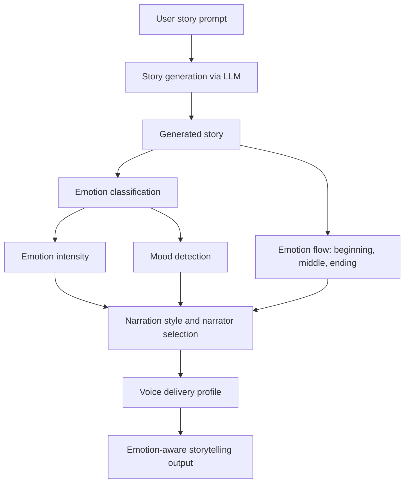

# EMO-AI — Emotion-Aware Storytelling Studio

> An AI-powered storytelling project designed to connect narrative generation with emotion analysis, narrator selection, and expressive voice guidance.

**EMO-AI** explores how a story's emotional journey can influence the way it is interpreted and presented. Its backend is organized into modular components for story generation, emotion classification, mood detection, narrator selection, and voice-parameter planning.

> **Project status:** The repository currently contains the core modules and a Next.js/FastAPI scaffold. The end-to-end workflow is still under development: a concrete LLM provider is not configured by default, and the emotion/narration modules are not yet wired into the `/story` API response. See [Current limitations](#current-status-and-limitations) before running the full demo.

## Contents

- [Overview](#overview)
- [How it works](#how-it-works)
- [Features and modules](#features-and-modules)
- [Technology stack](#technology-stack)
- [Project structure](#project-structure)
- [Getting started](#getting-started)
- [API reference](#api-reference)
- [Tests](#tests)
- [Current status and limitations](#current-status-and-limitations)
- [Roadmap](#roadmap)
- [Contributing](#contributing)

## Overview

Traditional story-generation applications focus on producing text. EMO-AI investigates an additional layer: **understanding the emotions expressed throughout a story and translating that analysis into narration guidance**.

For example, a story may begin with fear, build into suspense, and finish with relief. An emotion-aware storytelling pipeline could represent that progression and use it to recommend a suitable storytelling style and voice delivery.

### Intended pipeline



This diagram describes the **intended architecture**. In the current codebase, these modules exist separately and still need to be integrated into a single end-to-end request workflow.

## How it works

1. **Prompt input:** The user provides a short description of the story they want.
2. **Story generation:** The story-generation layer prepares instructions for an LLM and expects a structured JSON response containing a title, story, summary, and moral.
3. **Emotion analysis:** The emotion engine uses predefined emotion-related vocabulary and scoring logic to identify emotional signals in text.
4. **Intensity and mood:** Separate modules estimate emotion intensity and map detected emotions to a broader mood.
5. **Narrative progression:** The emotion-flow module examines the emotional pattern across sections of the story.
6. **Narrator and style selection:** Rule-based modules map emotional characteristics to a narrator personality and storytelling style.
7. **Voice guidance:** The voice-intelligence module produces structured delivery parameters, such as pace, pitch, energy, and emphasis.

The repository currently focuses on **text generation and narration planning**. It does not currently include a complete text-to-speech audio synthesis pipeline.

## Features and modules

| Module | Responsibility |
|---|---|
| Story generation | Defines the prompt and validates structured story output from an LLM provider |
| Story analysis | Extracts narrative information from a story |
| Emotion classification | Detects emotion-related words and calculates category scores |
| Emotion intensity | Calculates an intensity score from detected emotional signals |
| Mood detection | Maps emotion results to mood categories |
| Emotion flow | Represents emotional changes across the story |
| Narration style | Recommends a delivery style based on emotional characteristics |
| Narrator selection | Selects a narrator personality or voice category |
| Voice intelligence | Produces structured voice-delivery guidance |
| REST API | Exposes a FastAPI endpoint for story generation |
| Web frontend | Provides a Next.js interface scaffold |

## Technology stack

- **Backend:** Python, FastAPI, Pydantic
- **Frontend:** Next.js, React, TypeScript
- **AI integration design:** Provider-independent LLM interface
- **Testing:** Python test modules using test-style files included in the repository

The project defines an interface for an LLM provider rather than shipping a configured provider. A compatible adapter and its credentials/configuration must be added before generation can work.

## Project structure

```text
EMO-AI-main/
├── backend/
│   ├── AI/
│   │   ├── prompts.py
│   │   ├── story_generator.py
│   │   ├── story_analyzer.py
│   │   └── semantic_emotion/
│   ├── emotion_engine/
│   │   ├── emotion_classifier.py
│   │   ├── emotion_flow.py
│   │   ├── intensity_calculator.py
│   │   ├── mood_detector.py
│   │   └── narration_style.py
│   ├── narrator_selection/
│   ├── voice_intelligence/
│   ├── routers/
│   │   └── story.py
│   ├── schemas/
│   ├── services/
│   └── main.py
├── frontend/
│   ├── app/
│   ├── package.json
│   └── next.config.ts
├── docs/
└── README.md
```

## Getting started

### Prerequisites

- Python 3.10 or newer (Python 3.11+ recommended)
- Node.js compatible with the installed Next.js version (Node.js 20.9+ recommended for Next.js 16)
- npm

### 1. Clone the repository

```bash
git clone <YOUR_REPOSITORY_URL>
cd EMO-AI-main
```

Replace `<YOUR_REPOSITORY_URL>` with your Git repository URL.

### 2. Set up the backend

Create and activate a virtual environment:

**Windows (PowerShell)**

```powershell
python -m venv .venv
.venv\Scripts\Activate.ps1
```

**macOS/Linux**

```bash
python3 -m venv .venv
source .venv/bin/activate
```

Install the core web dependencies:

```bash
python -m pip install --upgrade pip
pip install fastapi "uvicorn[standard]" pydantic pytest
```

The repository does not currently include a backend `requirements.txt`. Add one as the backend dependencies are finalized so the environment can be reproduced reliably.

Start the API from the `backend` directory:

```bash
cd backend
uvicorn main:app --reload --port 8000
```

Open the API documentation at [http://localhost:8000/docs](http://localhost:8000/docs). The health route is available at [http://localhost:8000/](http://localhost:8000/).

> The API server can start without an LLM provider, but `POST /story` will not generate a story until a provider adapter is configured and injected into the story service.

### 3. Set up the frontend

In a second terminal, from the repository root:

```bash
cd frontend
npm install
npm run dev
```

Open [http://localhost:3000](http://localhost:3000).

The frontend is a scaffold and may require API integration updates before it works end-to-end with the current backend. In particular, the backend request schema expects a `prompt` field; ensure the frontend sends `{ "prompt": "..." }` to `POST /story`.

## API reference

### `GET /`

Returns a simple backend health response.

**Example response**

```json
{
  "message": "EMO-AI Backend Running"
}
```

### `POST /story`

Generates a structured story from a prompt, once an LLM provider is configured.

**Request body**

```json
{
  "prompt": "Write a short story about courage and friendship."
}
```

The prompt must contain between 3 and 2,000 characters.

**Expected response shape**

```json
{
  "title": "The Courage to Help",
  "story": "A young traveler discovers that courage can begin with one small act...",
  "summary": "A traveler learns the value of helping others.",
  "moral": "Small acts of courage can make a big difference."
}
```

The response is an example of the schema, not a guaranteed model output. The current route returns the four story fields; emotion analysis and voice-delivery results are not yet included in this endpoint.

## Tests

Test modules are included alongside the emotion, narrator-selection, semantic-emotion, and voice-intelligence components. From the repository root, try:

```bash
python -m pytest backend -q
```

If tests cannot import modules when run from the repository root, run them with the backend directory as the working directory and adjust the Python import path as needed. The project does not currently define a standardized test configuration.

## Current status and limitations

The repository is an active prototype rather than a fully integrated production application. The following items should be addressed before presenting the entire pipeline as functional:

- **LLM provider:** `StoryGenerator` requires a provider implementation, but no concrete provider is configured by default.
- **Pipeline integration:** Emotion analysis, emotion flow, narrator selection, and voice intelligence are separate modules and are not called by the current `/story` route.
- **Frontend request contract:** Confirm the frontend sends the `prompt` field expected by the backend schema.
- **Dependency management:** Add a backend `requirements.txt` or `pyproject.toml` and document the supported Python version.
- **Configuration and security:** Move provider keys and environment-specific settings into environment variables; configure allowed CORS origins for deployment rather than using a wildcard.
- **Voice output:** Voice intelligence currently describes delivery parameters; audio synthesis would require a separate text-to-speech integration.

## Roadmap

- [ ] Add and configure an LLM provider adapter.
- [ ] Connect story generation to emotion analysis.
- [ ] Return emotion scores, mood, intensity, and emotion-flow information through the API.
- [ ] Integrate narrator selection and voice-delivery profiles into the response.
- [ ] Align frontend request/response handling with the API schemas.
- [ ] Add backend dependency management and environment-variable documentation.
- [ ] Standardize automated tests and add API integration tests.
- [ ] Optionally integrate a text-to-speech provider for spoken narration.
- [ ] Add screenshots, a demo, and deployment instructions.

## Contributing

Contributions and suggestions are welcome. A useful contribution should:

1. Keep emotion, narrator, and voice modules modular and testable.
2. Include tests for new scoring rules or pipeline behavior.
3. Avoid committing API keys, secrets, virtual environments, or generated build artifacts.
4. Update this README when setup instructions, API contracts, or capabilities change.

## License

No license is currently specified in this repository. Add a `LICENSE` file before distributing or reusing the project publicly.

---

**EMO-AI** — exploring the intersection of storytelling, emotion understanding, and expressive narration.
